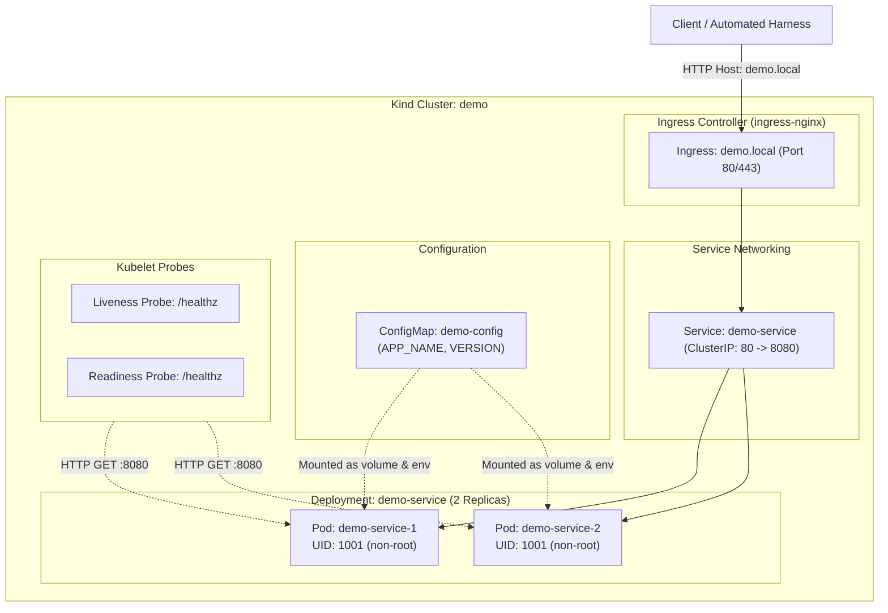
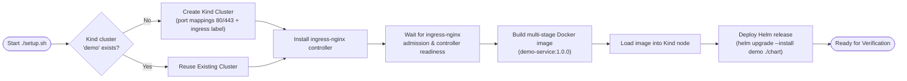
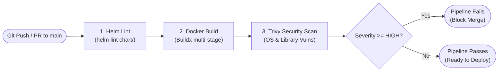
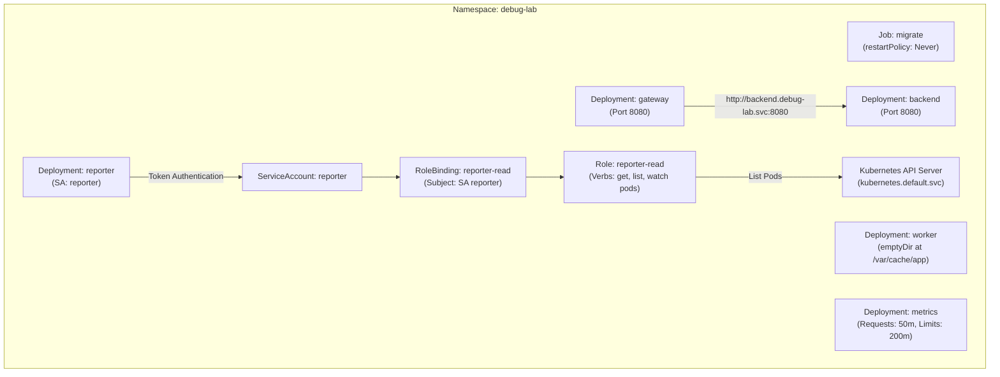

# DevOps / Platform Engineer Take-Home Assignment (v2)

This repository contains the complete implementation for the DevOps / Platform Engineer take-home assessment for Enterprise Bot GmbH.

---

## Architecture & Workflows

### 1. System Architecture & Request Flow (Parts 1 & 2)



---

### 2. Idempotent Environment Setup Workflow (`setup.sh`)



---

### 3. Continuous Integration & Security Pipeline (`.github/workflows/ci.yml`)



---

### 4. Part 4 Lab Microservices Architecture (`lab/`)



---

## 1. How to Run and Verify

### Prerequisites
- Docker (running)
- `kind`
- `kubectl`
- `helm`

### End-to-End Setup (Parts 1–3)
Run the root idempotent setup script:
```bash
chmod +x ./setup.sh
./setup.sh
```
The script will:
1. Create (or reuse) a Kind cluster named `demo` configured with extra port mappings (`80`/`443`) and ingress-ready node labels.
2. Install the `ingress-nginx` controller and wait for its webhook and controller pods to become fully ready.
3. Build the multi-stage, non-root Docker image `demo-service:1.0.0` from `service/` and load it into the Kind cluster.
4. Deploy the Helm chart from `chart/` into namespace `demo` as release `demo`.

To test idempotency, execute `./setup.sh` a second time: it will update in-place with zero errors.

### Verifying the Service (Parts 1 & 2)
Verify that the service is running, responsive, and serving through Ingress:
```bash
# Check deployed pods in the demo namespace
kubectl get pods -n demo

# Test HTTP endpoints directly via Ingress (host demo.local mapped to localhost)
curl -H "Host: demo.local" http://localhost/
# Output: {"app":"demo-app","version":"1.0.0","pod":"demo-service-..."}

curl -i -H "Host: demo.local" http://localhost/healthz
# Output: HTTP/1.1 200 OK
```

### Verifying Part 4 (Lab Debugging)
Navigate to `lab/` and run the verification scenario:
```bash
cd lab
./scenario.sh up
./scenario.sh verify
```

---

## 2. Resource Requests and Limits (and Why Those Numbers)

For both the custom service (`chart/values.yaml`) and the debug lab microservices (`lab/broken-chart/values.yaml`), the following values were chosen:

```yaml
resources:
  requests:
    cpu: "50m"
    memory: "64Mi"
  limits:
    cpu: "200m"
    memory: "128Mi"
```

### Why these specific numbers?
1. **Application Profile**:
   - The services (`demo-service` and `eb-debug-app`) are lightweight HTTP microservices running minimal Python/FastAPI and Go runtimes.
   - Idle CPU consumption is below `5m`, and active HTTP request handling typically consumes `15m`–`35m`. A baseline request of `50m` guarantees predictable CPU allocation without wasting node capacity.
   - Memory footprint under load hovers between `25Mi` and `45Mi`. A `64Mi` request prevents paging and ensures reliable placement during scheduler bin-packing.

2. **Cluster Guardrails & LimitRange Compliance**:
   - In `lab/cluster-state/limits.yaml`, the namespace is governed by a `LimitRange` with `max.cpu: "1"` and `max.memory: 512Mi`.
   - Setting limits to `200m` CPU and `128Mi` memory stays well within namespace admission constraints while providing a 4x burst ceiling over requests to handle transient traffic spikes without risk of CPU starvation or OOM kills (`exit code 137`).

---

## 3. What Was Deliberately Skipped & Associated Risks

| Component / Feature | Why Deliberately Skipped | Risk of Skipping | Mitigation in Production |
|---|---|---|---|
| **Horizontal Pod Autoscaler (HPA)** | Scope is limited to a local Kind single-node demonstration with fixed replica count. | Traffic surges could exhaust container CPU limits, increasing p99 latency or dropping requests. | Deploy Metrics Server and configure HPA targeting 70% CPU / 80% memory utilization. |
| **PodDisruptionBudgets (PDB)** | Static replica counts (2 replicas) in a local development cluster. | Node drains, upgrades, or preemption could terminate all replicas simultaneously, causing downtime. | Add a PDB requiring `minAvailable: 1`. |
| **NetworkPolicies** | In Kind, default CNI (kindnet) does not enforce standard NetworkPolicies out of the box without Calico/Cilium. | Unrestricted lateral traffic movement between namespaces and workloads (e.g., untrusted pods probing internal endpoints). | Implement default-deny ingress/egress policies and allow only explicit service-to-service communication. |
| **cert-manager & Automated TLS** | Used plain HTTP over port 80 to avoid local self-signed certificate trust setup on macOS. | Traffic in transit is unencrypted (plain text), exposing headers and payloads to inspection. | Integrate `cert-manager` with Let's Encrypt / Vault issuing automated TLS certificates. |
| **Persistent Storage / PVCs** | Workloads are stateless; worker cache uses ephemeral `emptyDir`. | Cached data is lost on pod restart. | Acceptable for cache; use StatefulSets with CSI PVCs if persistence is required. |

---

## 4. What Would Change to Make This Production-Ready

1. **Multi-Node High Availability & Topology Spread**:
   - Deploy across a minimum of 3 availability zones with `topologySpreadConstraints` (or `podAntiAffinity`) to ensure replicas do not land on the same physical node or failure domain.
2. **Enterprise Ingress & Gateway API**:
   - Migrate from legacy `ingress-nginx` to Kubernetes Gateway API with cloud-native load balancers (AWS NLB/ALB, GCP Cloud Load Balancing) supporting WAF, DDoS mitigation, and HTTP/2 or HTTP/3.
3. **Observability & Distributed Tracing**:
   - Instrument applications with OpenTelemetry SDKs exporting traces, metrics, and structured JSON logs to Grafana / Prometheus / Loki / Tempo.
4. **GitOps & Continuous Delivery**:
   - Manage deployments declaratively via ArgoCD or Flux with automated canary rollouts (Argo Rollouts) driven by automated error-budget analysis.
5. **Security Hardening**:
   - Enforce Kyverno or OPA Gatekeeper admission policies (e.g., `Restricted` Pod Security Standards: immutable root filesystems, non-root enforcement, seccomp profiles).
   - Use automated image vulnerability scanning (Trivy) and signed image verification (Cosign/Sigstore) in CI/CD.

---

## 5. How I Used AI

- **AI Tools Used**: Google Antigravity / Gemini agentic assistant.
- **Where It Helped**:
  - Accelerated initial scaffolding for `service/`, `chart/`, and the idempotent Kind setup script in `setup.sh`.
  - Disassembled and analyzed the prebuilt `ebinterview/eb-debug-app:1.0.1` Go binary to identify assembly offsets (e.g., locating the `io.LimitReader(resp.Body, 1024)` instruction at `0x6a3b5c`).
  - Diagnosed Rosetta 2 emulation requirements for running `amd64` Go binaries on Apple Silicon macOS hosts.
- **What Had to Be Corrected / Guided**:
  - Automated sandbox permissions for `.kube/config` and Docker socket access on macOS.
  - Ensuring strict adherence to assignment rules: avoiding any modifications to pristine `cluster-state/` files or changing the handout's prebuilt image repository and tag.
